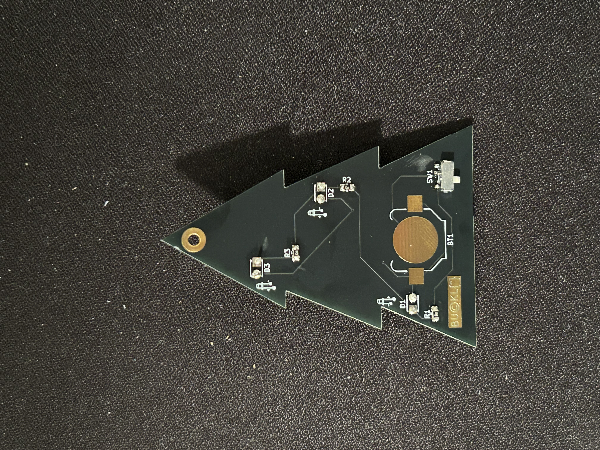

# Christmas Tree 2024

The below image demonstrates the correct orientation and placement of the diodes and resistors.
Follow the diagram on the back of the pcb. With the shorter leg (cathode) going into the square hole from the front of the pcb and the long leg (anode) going into the round hole.
After the led is soldered in place you can safely snip the legs.

solder the battery clip by adding solder to both of the square pads on either side of the large circle such that it will fit in the following orientation:

I unfortunately only had 68 Ohm resistors which are slightly too resistive and the LEDs at the top show a little dull.
If you would like them a little more brilliant you can either replace the resisistors with 62 Ohm resistors or bypass one or both of the resistors by soldering a wire directly to the first trace.
Be aware if you do this the LEDs can short out, or it will drain the battery earlier because the resistance in the circuit will be too low.

The on position of the switch is in the position marked on the board. Make sure to solder the switch with the three legs fitting into the solder pads.

## External 3.3 V power

J1 is an unpopulated two-pin through-hole header. Pin 1 (square pad, marked `-`) is the return; pin 2 (marked `+`) accepts 3.3 V. The existing switch still controls the LEDs.

JP1 selects the power source. Its factory copper bridge joins pads 1 and 2 for battery power. To use J1 while leaving the battery installed, cut the bridge between pads 1 and 2, check that the pads are no longer connected, then solder a bridge between pads 2 and 3. Bridge only one side of JP1 at a time. To return to battery power, remove the 2–3 bridge and reconnect pads 1 and 2.

The files in `gerber/` describe the original battery-only board. Regenerate fabrication files from the KiCad project to manufacture the board with J1 and JP1.

Alternatively you can just enjoy the ornament for what it is without any leds.

Merry Christmas!
